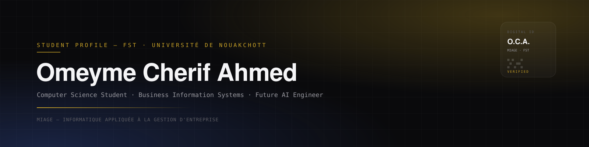

 

 

 

## About &#183; À propos

<table>
<tr>
<td valign="top" width="50%">

**English**

Computer science student specializing in **Informatique Appliquée à la Gestion d'Entreprise (MIAGE)** at the Faculté des Sciences et Techniques (FST), Université de Nouakchott — a program at the intersection of software engineering, information systems, and business management.

Interested in **AI**, **data**, and **business process analysis**, with a focus on building systems that are both technically sound and useful to the organizations that run on them. Currently building toward a career as an AI engineer.

</td>
<td valign="top" width="50%">

**Français**

Étudiante en informatique, spécialisation **Informatique Appliquée à la Gestion d'Entreprise (MIAGE)** à la Faculté des Sciences et Techniques (FST), Université de Nouakchott — une formation au croisement du génie logiciel, des systèmes d'information et de la gestion d'entreprise.

Intéressée par l'**IA**, la **donnée**, et l'**analyse des processus métier**, avec une attention particulière portée aux systèmes à la fois solides techniquement et réellement utiles aux organisations qui les utilisent. En construction vers un parcours d'ingénieure IA.

</td>
</tr>
</table>

 

## Toolkit

`Business Process Analysis` &nbsp;&#183;&nbsp; `ERP Systems` &nbsp;&#183;&nbsp; `Power BI` &nbsp;&#183;&nbsp; `Merise / UML` &nbsp;&#183;&nbsp; `Data Analysis`

 

## GitHub Activity

 

## Pinned Projects

> See [`REPO_IDEAS.md`](./REPO_IDEAS.md) for the full project roadmap and which six repos to pin.

 

## Currently

- 🎓 Studying **MIAGE** at FST, Université de Nouakchott
- 🌱 Deepening skills in **AI/data** and **full-stack web development**
- 💬 Open to **internships**, collaborative projects, and conversations about AI and business systems
- 📫 Reach me via the links above

 

Built with intention.

